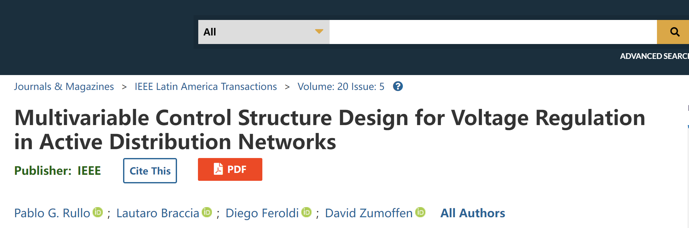
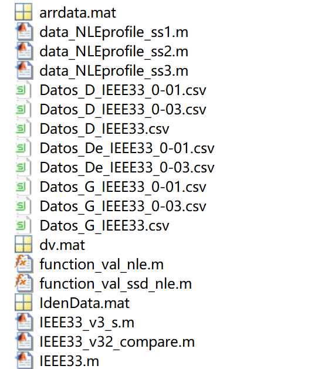
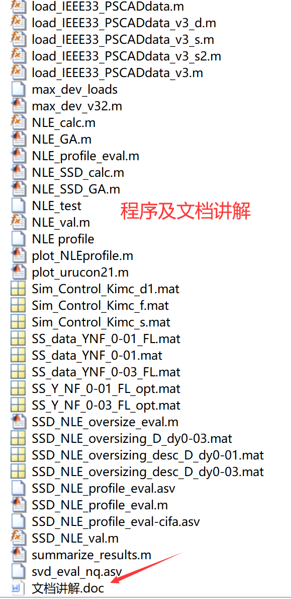

# Active Power Distribution Network Voltage Regulation (Matlab Code Implementation)

\nStanding on the shoulders of giants, this document's code reproduction.  
Data:  
\n\n\n\n\n

## Images

<!-- PAYMENT_BLOCK -->

## Get this dataset

- Payment link (Stripe): [Buy now](https://buy.stripe.com/3cs8yP7sY87d0vu9AB)
- Payment QR code: 

<!-- /PAYMENT_BLOCK -->
